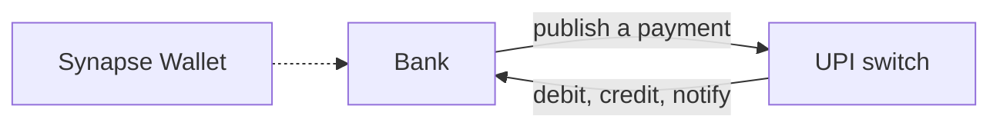

# Synapse

Synapse is a small payments network. A person pays with a virtual address such as `raiyan@city`. Banks publish those payments to a switch, and the switch is the only place that decides what happens next: resolve the addresses, ask the payer's bank to debit, ask the payee's bank to credit, and reverse the debit if the credit fails.



The wallet is the client. The dashed line is the intended path: the app still keeps its own profile, balance, and transactions on the device.

## Layout

| Path | Role |
| --- | --- |
| [`apps/upi`](apps/upi) | The switch. Spring Boot 4.1, Java 25, PostgreSQL, RabbitMQ. |
| [`apps/bank`](apps/bank) | A participating bank. Spring Boot 4.1, Java 25, PostgreSQL. |
| [`apps/mobile`](apps/mobile) | Synapse Wallet. Flutter. |
| [`libs/common`](libs/common) | Shared HTTP envelope, error types, and request ids for the Java services. |

`apps/upi` and `apps/bank` are separate Gradle builds. Each one pulls in `libs/common` with `includeBuild`.

## Requirements

- Java 25, for the switch, the bank, and `libs/common`
- PostgreSQL, one database per service (`upi` and `bank`)
- RabbitMQ, for the switch (`apps/upi`)
- Flutter SDK `^3.13.5`, for the wallet

## Run the services

From the service directory, copy the env template and start Gradle. `bootRun` reads `.env` and exports each `KEY=VALUE` line. An IDE run does not load that file.

```bash
cd apps/upi
cp .env.example .env
./gradlew bootRun
```

```bash
cd apps/bank
cp .env.example .env
./gradlew bootRun
```

Create the database named in `.env.example` before the first start. Hibernate updates the schema from entities on startup. The switch listens on port 8080 and the bank on port 9090. Set `SERVER_PORT` to change either one.

Variable names, a local Postgres URL, and a Neon URL are in [apps/upi/README.md](apps/upi/README.md) and [apps/bank/README.md](apps/bank/README.md).

The bank exposes one demo route, `GET http://localhost:9090/demo/accounts/{id}`, so you can see the shared response shape. Any id other than `missing` returns the account. `missing` returns 404.

## Run the wallet

```bash
cd apps/mobile
flutter pub get
flutter run
```

The app is a wallet UI: login gate, balance, send and receive, QR, on-device biometrics, and a PDF receipt. Profile and transactions are stored with `shared_preferences`. The comments at the top of [`apps/mobile/lib/main.dart`](apps/mobile/lib/main.dart) list the endpoints a real backend would replace that mock data with.

## A payment

Virtual addresses look like `name@bank`. The part after `@` is the bank handle.

1. A bank publishes a payment. The switch accepts it and returns an atomic id.
2. The switch resolves both addresses. A handle it cannot resolve ends the payment before any money moves.
3. The payer's bank authorizes the debit.
4. The payee's bank credits the payee. A rejected credit is reversed at the payer's bank.
5. On success, the switch tells both banks, then the payment is complete.

## Shared HTTP shape

`libs/common` wraps every controller return value and every thrown HTTP exception:

```json
{
  "success": true,
  "data": { "id": "100", "bank": "city" },
  "meta": { "requestId": "...", "timestamp": "..." }
}
```

Failures use the same envelope with `success: false` and an `error` object. Send `X-Request-Id` and that id comes back in `meta`.

## Tests

```bash
cd libs/common && ./gradlew test
cd apps/bank && ./gradlew test
cd apps/upi && ./gradlew test
```
