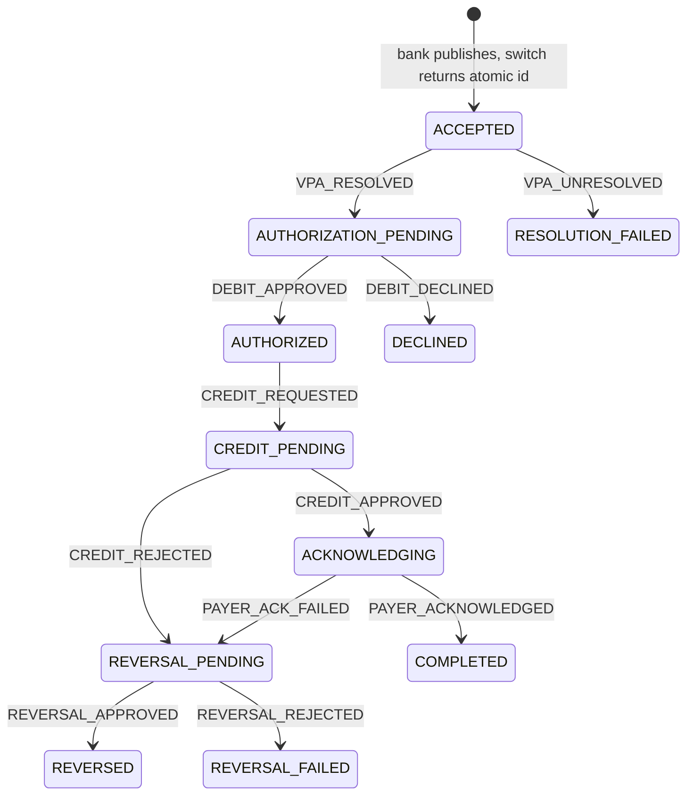

# Payment state machine

The UPI service is the ledger. The payee's bank publishes a payment, the ledger returns an atomic id, and every later step is a transition on that payment. This file is the handoff for that lifecycle.

## Library

Transitions are defined and enforced by [Spring Statemachine](https://docs.spring.io/spring-statemachine/docs/4.0.2/reference/index.html) `4.0.2`.

| Piece | Role |
| --- | --- |
| `spring-statemachine-core` | The dependency in `build.gradle.kts`. This is the module to keep. |
| `PaymentStateMachineConfig` | `@EnableStateMachineFactory` configuration. States, end states, and external transitions live here. |
| `PaymentStateMachine` | Builds one machine from `StateMachineFactory` per call, restores the payment's current state, sends one event, and returns the next state. |
| `Payment` | The payment the ledger tracks. `atomicId` is the id returned to the payee's bank. `payerVa`, `payeeVa`, and `amount` travel with it. |

`spring-statemachine-starter` and the JPA, Redis, and Mongo persistence modules are built for Spring Boot 3.5. This service is Spring Boot 4.1, and the Statemachine project has no Boot 4 support. Leave those modules out. When a payment is stored, store it as a normal JPA entity. The state machine is the transition engine, not the database.

A denied event throws `IllegalPaymentTransitionException`. Spring Statemachine reports that as `StateMachineEventResult.ResultType.DENIED`.

## What the ledger does

1. The payee's bank publishes a payment. The ledger accepts it, mints an atomic id, and returns that id. The payment is `ACCEPTED`.
2. The ledger resolves the payer's virtual address (`name@bank`, for example `raiyan@city`). The part after `@` is the bank handle. Resolution happens before any money moves. If the handle cannot be resolved, the payment ends as `RESOLUTION_FAILED` and the ledger tells the payee's bank.
3. The ledger asks the payer's bank to verify the payment and debit. Balance, limits, and whether the payment may proceed are decided by that bank. On approval the payment is `AUTHORIZED` and the payer has been debited. On refusal it ends as `DECLINED` and the ledger tells the payee's bank. The payer's bank notifies its user of a refusal itself, because it made that decision.
4. The ledger sends a credit request to the payee's bank. The payment is `CREDIT_PENDING` while that bank has not answered.
5. If the payee's bank credits the payee, that bank notifies its user. The payment moves to `ACKNOWLEDGING`. The ledger then acknowledges the payer's bank. That bank notifies its user. After the acknowledgement is accepted, the payment is `COMPLETED`. If the acknowledgement fails, the ledger sends a reversal request and the payment moves to `REVERSAL_PENDING`.
6. A reversal is also required when the payee's bank rejects the credit, because the payer has already been debited. A successful reversal ends as `REVERSED`. A failed reversal ends as `REVERSAL_FAILED`: the payer is still debited.

The payee's bank and the payer's bank may be the same institution. Verification is still its own step. The debit decision happens when the payer's bank answers, not when the payment is published.

## States

There are 11 states. Five of them are terminal, configured as Spring Statemachine end states.

| State | Waiting on | Money | Terminal |
| --- | --- | --- | --- |
| `ACCEPTED` | The switch, to resolve the virtual addresses | None | No |
| `AUTHORIZATION_PENDING` | The payer's bank | None | No |
| `AUTHORIZED` | The switch, to send the credit | Payer debited | No |
| `CREDIT_PENDING` | The payee's bank | Payer debited | No |
| `ACKNOWLEDGING` | The payer's bank, for the completion acknowledgement | Settled | No |
| `COMPLETED` | Nobody | Settled | Yes |
| `RESOLUTION_FAILED` | Nobody | None | Yes |
| `DECLINED` | Nobody | None | Yes |
| `REVERSAL_PENDING` | The payer's bank | Debit must be undone. The payee may already have been credited | No |
| `REVERSED` | Nobody | Debit undone | Yes |
| `REVERSAL_FAILED` | Nobody | Payer still debited, payee not credited | Yes |

`AUTHORIZED` and `CREDIT_PENDING` are separate so a retry does not send a second credit. `AUTHORIZED` means the debit is done and the credit has not been sent. `CREDIT_PENDING` means the payee's bank has been asked and has not answered.

`ACKNOWLEDGING` and `COMPLETED` are separate so a crash while acknowledging the payer's bank does not look like the credit is still in flight. The payee's bank notifies its own user when it accepts the credit, so the ledger does not send that notice. The ledger owes one acknowledgement to the payer's bank. When that bank accepts it, apply `PAYER_ACKNOWLEDGED`. When the acknowledgement fails, apply `PAYER_ACK_FAILED` and send the reversal request. A thrown error from the acknowledgement step is a crash: DBOS runs that step again. A returned failure is the bank refusing the acknowledgement, and that is what starts the reversal.

## Transitions

There are 11 external transitions. Anything not in this table is denied.

| From | Event | To | What happened before the event is applied |
| --- | --- | --- | --- |
| `ACCEPTED` | `VPA_RESOLVED` | `AUTHORIZATION_PENDING` | Both virtual addresses resolved, and the debit authorization was sent to the payer's bank |
| `ACCEPTED` | `VPA_UNRESOLVED` | `RESOLUTION_FAILED` | A virtual address could not be resolved. No bank was asked to move money |
| `AUTHORIZATION_PENDING` | `DEBIT_APPROVED` | `AUTHORIZED` | The payer's bank approved the debit |
| `AUTHORIZATION_PENDING` | `DEBIT_DECLINED` | `DECLINED` | The payer's bank refused. It did not debit |
| `AUTHORIZED` | `CREDIT_REQUESTED` | `CREDIT_PENDING` | The credit request was sent to the payee's bank |
| `CREDIT_PENDING` | `CREDIT_APPROVED` | `ACKNOWLEDGING` | The payee's bank credited the payee and notifies its user |
| `CREDIT_PENDING` | `CREDIT_REJECTED` | `REVERSAL_PENDING` | The payee's bank rejected the credit. A reversal is now required |
| `ACKNOWLEDGING` | `PAYER_ACKNOWLEDGED` | `COMPLETED` | The payer's bank accepted the completion acknowledgement and notifies its user |
| `ACKNOWLEDGING` | `PAYER_ACK_FAILED` | `REVERSAL_PENDING` | The payer acknowledgement failed after the credit. A reversal is now required |
| `REVERSAL_PENDING` | `REVERSAL_APPROVED` | `REVERSED` | The payer's bank reversed the debit |
| `REVERSAL_PENDING` | `REVERSAL_REJECTED` | `REVERSAL_FAILED` | The payer's bank did not reverse the debit |



Apply an event only after the step it names has happened. If sending a request to a bank fails, leave the payment in the previous state and retry the send. Enter `AUTHORIZATION_PENDING` only after the payer's bank was asked. Enter `CREDIT_PENDING` only after the payee's bank was asked.

`REVERSAL_PENDING` means a reversal is required. Send it if it has not been sent. The payer bank's answer is the only way out. A repeated reversal request for the same atomic id must be safe.

On `DECLINED` and `RESOLUTION_FAILED`, tell the payee's bank. That report is retried without a further transition. The payee's bank already knows when it rejects the credit. The payer's bank already knows when it declines, and it learns a reversal from the reversal request. `REVERSAL_FAILED` is terminal inside this machine. Do not add an automatic loop back to `REVERSAL_PENDING`.

## Rules for the next change

- Keep new transitions in `PaymentStateMachineConfig`. The enum `terminal()` flag and the `.end(...)` states stay in agreement.
- Leave balance, limit, and risk checks on the payer's bank.
- Resolve virtual addresses before asking for a debit. Credit only after `DEBIT_APPROVED`.
- One atomic id per payment, minted in `Payment.accept`. Callers treat it as an opaque token.
- A virtual address is `name@bank`: one `@`, with text on both sides.
- The ledger does not notify users. The payee's bank notifies its user when it credits. The payer's bank notifies its user after it accepts the completion acknowledgement.
- A failed payer acknowledgement after a successful credit moves to `REVERSAL_PENDING` and the ledger sends the reversal request. Do not leave that credit standing.
- Timeouts are not states. Map one onto `DEBIT_DECLINED` or `CREDIT_REJECTED` only once the bank outcome is known.
- `PaymentStateMachine` restores state onto a fresh machine for each call. Do not cache one running machine and reuse it across payments.

## Durable execution

DBOS runs in this process. It does not need its own database. With `dbos.datasource.url` unset, it uses `spring.datasource` and creates its tables in the `dbos` schema.

`dbos.datasource.use-listen-notify` is false because the Neon pooler does not deliver `LISTEN`/`NOTIFY`. DBOS polls for bank replies. A direct connection to Postgres can turn that flag back on.

`PaymentWorkflow.start` mints the atomic id and starts one workflow with that id. These steps are checkpointed, so a restart does not repeat a finished one:

| Step | Then the workflow applies |
| --- | --- |
| `resolve` | `VPA_RESOLVED`, or `VPA_UNRESOLVED` when it returns false |
| wait for a debit reply | `DEBIT_APPROVED` or `DEBIT_DECLINED` |
| `requestCredit` | `CREDIT_REQUESTED` |
| wait for a credit reply | `CREDIT_APPROVED` or `CREDIT_REJECTED` |
| `acknowledgePayer` returns true | `PAYER_ACKNOWLEDGED` |
| `acknowledgePayer` returns false | `PAYER_ACK_FAILED`, then `requestReversal` |
| `requestReversal` | the reversal reply, `REVERSAL_APPROVED` or `REVERSAL_REJECTED` |

A bank reply enters through `PaymentWorkflow.signal`. `PaymentSignal` chooses the topic. The workflow applies that event with `PaymentStateMachine`. Calls inside the workflow go through the Spring proxy (`self`), because a direct `this` call skips the DBOS checkpoint.

The step bodies do not call the banks yet. The directory, the debit, the credit, the reversal, the payer acknowledgement, and the report back to the payee's bank replace those bodies. The `@Step` boundary stays. `acknowledgePayer` returns false when the payer's bank rejects the acknowledgement. That return sends the reversal. `reportToPayee` retries when the report itself fails.

## Publish

`POST /payments`. The payee's bank publishes a payment. The atomic id is minted by the ledger and returned in the response body. It is not a path segment.

```json
{
  "payerVa": "mina@city",
  "amount": "10.00",
  "payeeVa": "raiyan@city"
}
```

`payerVa` is the virtual address the money leaves. `payeeVa` is how the ledger finds the payee's bank. `amount` is what moves. The shared envelope wraps the response, and `data.atomicId` is the id the bank tracks. Names, a note, and a currency are not on this request: the directory supplies the names, and this network has one currency.

Later replies from a bank will carry that same id in the body. Those routes are not built yet.

## Not built yet

No payment table, no virtual-address directory, and no client that calls the payer or payee bank. Debit, credit, and reversal replies are not routes yet.
